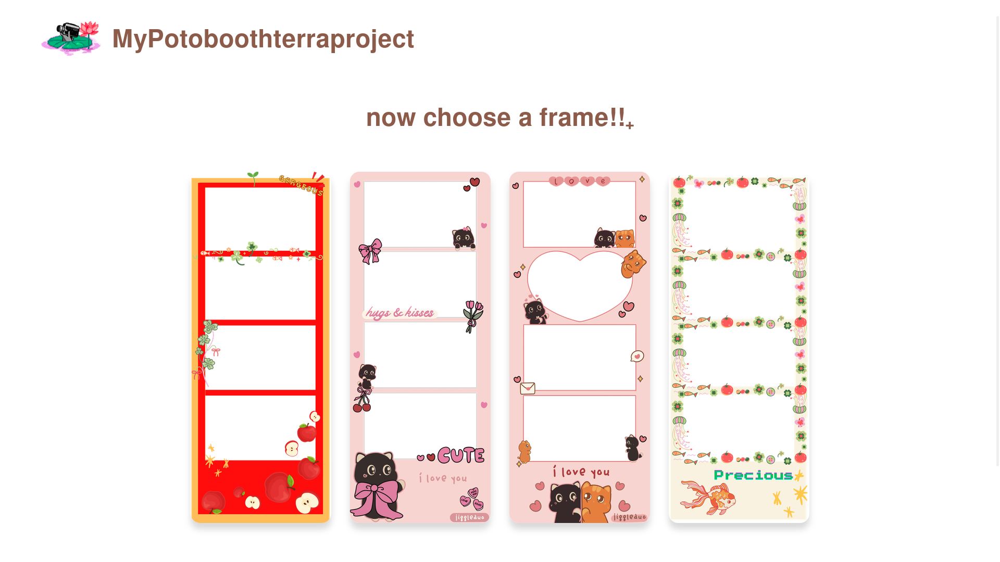
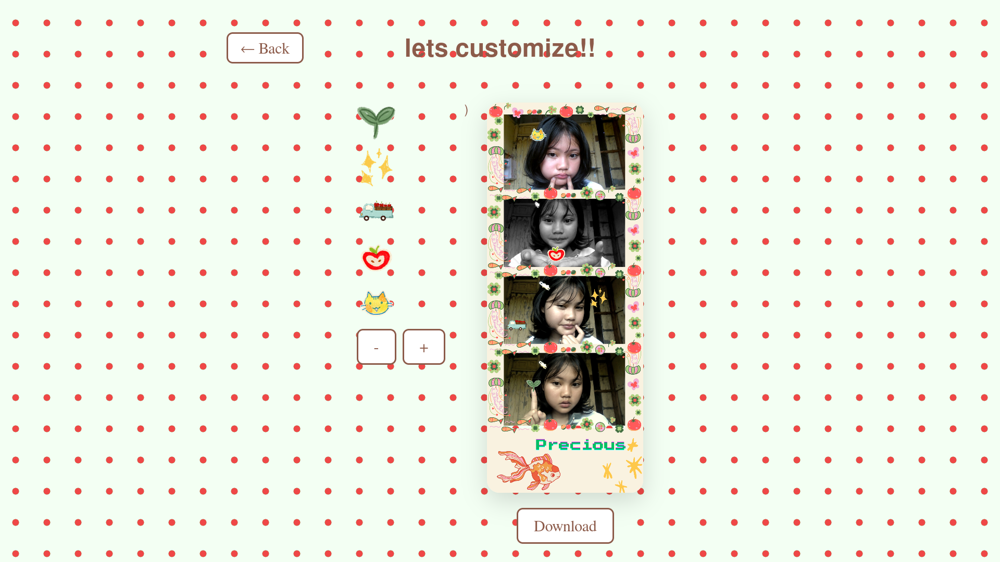

# mypotoboothterraproject
# Art Photo Booth

## About the Project

Art Photo Booth is a creative web application that lets users take photos using their webcam and customize them with artistic photo frames. I wanted to create a photo booth with a cute visual style and a unique design.

## Live Demo

https://mypotoboothterraproject-mu.vercel.app/

## Features

- Webcam integration using React Webcam.
- Multiple photo frame options.
- Custom-designed photo frames.
- Personalized logo and visual assets.
- A creative interface with a cute aesthetic.

## Built With

- React
- JavaScript
- HTML
- CSS
- React Webcam
- Vercel

## How I Built It

I started with an existing React photo booth template and customized it to match my own ideas. I modified the interface, designed and added custom photo frames, changed the logo, and added visual assets.

This project is part of my journey learning web development and building my own creative applications.

## Screenshots

### Homepage

### Photo Booth

## Credits

This project uses an existing React photo booth template as its foundation. I customized the design and assets to develop my own version.

## How to Use

1. Open the live demo: https://mypotoboothterraproject-mu.vercel.app/
2. Allow camera access when your browser asks for permission.
3. Select a photo frame from the available options.
4. Use the photo booth interface to take photos.

## How to Run Locally

1. Install Node.js and npm.
2. Clone this repository.
3. Open the project directory in your terminal.
4. Install dependencies:

   `npm install`

5. Start the development server:

   `npm start`

6. Open http://localhost:3000 in your browser.

